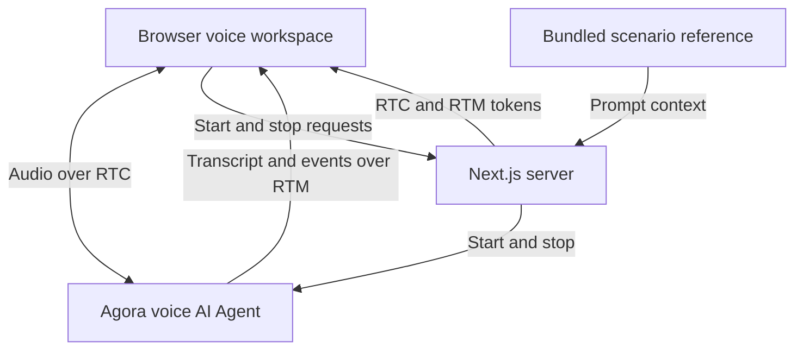

# Agora Event Reminder Assistant Demo

A voice AI event reminder demo built with Agora and Next.js. Role-play a reminder for a fictional webinar, ask about its agenda and timing, and discuss whether you plan to attend.

**[Explore more voice AI demos on Agora Recipes →](https://recipes.agora.io/)**

[](https://www.agora.io/en/products/conversational-ai-engine/)
[](https://nextjs.org/docs)
[](LICENSE)

[Features](#features) · [Tech stack](#tech-stack) · [Run locally](#run-locally) · [Deploy to Vercel](#deploy-to-vercel) · [How it works](#how-it-works) · [Customize](#customize) · [FAQ](#faq) · [More](#more)

<!-- Recipes URL: add the published Agora Recipes page URL here. -->
<!-- Video placement: add a linked cover image here once the actual demo video is ready. Show a caller hearing the fictional event schedule, asking an agenda question, and correcting an attendance intention. Use a descriptive alt and public video URL. Verify playback or fallback links on GitHub and Recipes. -->

<a id="what-you-can-do"></a>

## Features

- **Event introduction:** hear a short reminder after agreeing to continue.
- **Schedule and agenda:** ask about the example webinar's audience, topics, duration, and time-zone conversions.
- **Attendance conversation:** say yes, no, or undecided and revise your intention during the call.
- **Summary:** ask the assistant to repeat the event time and whether you plan to attend.
- **Voice and transcript:** follow the reminder conversation in audio and text.

## Tech Stack

- **Frontend:** Next.js, React, TypeScript.
- **Voice AI:** Agora Conversational AI, Agents SDK, RTC and RTM.
- **Models:** Deepgram STT, OpenAI LLM, MiniMax TTS.

<a id="quick-start"></a>
<a id="run-it"></a>
<a id="try-it"></a>
<a id="conversation"></a>

## Getting Started

### Run Locally

You need Node.js 24, pnpm 9.15.9, and an [Agora project](https://console.agora.io/) with Conversational AI enabled.

**1. Install and configure**

Clone or download this repository, then open a terminal in its directory.

```bash
pnpm install --frozen-lockfile

if [ ! -f .env.local ]; then
  cp env.local.example .env.local
fi
```

Create or select a project in [Agora Console](https://console.agora.io/). Open **Manage credentials** and copy its **App ID** and **Primary certificate** into `.env.local` ([instructions](https://docs.agora.io/en/introduction/console-setup)):

```dotenv
NEXT_PUBLIC_AGORA_APP_ID=your_agora_app_id
NEXT_AGORA_APP_CERTIFICATE=your_agora_app_certificate
```

You don’t need separate API keys for the default speech and language models. Put the App Certificate in `.env.local` and never expose it in browser code.

See [env.local.example](env.local.example) for the configuration template.

**2. Start the app**

```bash
pnpm run doctor
pnpm run dev
```

Open [http://localhost:3000](http://localhost:3000), choose **Start event reminder**, and allow microphone access. Ask the assistant to summarize the conversation if needed, then click the hang-up button (**End session**).

<a id="deployment"></a>

### Deploy to Vercel

[](https://vercel.com/new)

1. Import this repository into Vercel.
2. Select **Next.js** and Node.js 24.
3. Add `NEXT_PUBLIC_AGORA_APP_ID` and `NEXT_AGORA_APP_CERTIFICATE` under **Environment Variables**, then deploy.

## How It Works

1. **Start a conversation:** Choose **Start event reminder** and allow microphone access.
2. **Hear the reminder:** Agree to hear the fictional webinar’s date, time, and agenda.
3. **Share your intention:** Say whether you plan to attend, decline, or remain undecided.
4. **Review the details:** Ask for time-zone clarification or correct your attendance intention.

### Architecture



Next.js issues browser tokens and supplies the scenario instructions when starting the Agora Agent. Conversation behavior is prompt-driven; no live business system is connected. See [ARCHITECTURE.md](ARCHITECTURE.md) for details.

<a id="faq-and-limitations"></a>

## FAQ

### Do I need an event or calendar service to try this demo?

No. The demo generates a fictional webinar schedule for each new conversation.

### What should I say when the reminder starts?

Agree to hear it, ask a schedule or agenda question, or say whether you plan to attend. Try “Yes, please give me the short reminder,” then “What time is it in California?” You can decline or change your intention during the call.

### Why does the event date change in a new call?

Each new call uses a fictional webinar on the following New York calendar day, from 2 to 2:45 PM Eastern. That schedule stays fixed within the call. This keeps the demo usable over time; it does not move a real event or schedule a notification.

### Why can’t I start a voice session?

Check browser microphone permission, the selected input device, and your Agora App ID, App Certificate, and Conversational AI access. Use localhost or HTTPS. Run `pnpm run doctor` for local configuration checks, then use the page’s error message to guide a retry.

### Can I save a copy of the conversation?

Yes. Open Inspector and select **Export session evidence** to download the current or latest call as JSON. Export it before starting another call or refreshing the page.

<a id="customize"></a>

### How do I make this demo more realistic?

Connect your own knowledge base and business services using [RAG](https://docs.agora.io/en/ai/build/custom-model-integration/custom-llm), [tool calling](https://docs.agora.io/en/ai/build/tools/custom-tools), or [MCP](https://docs.agora.io/en/ai/build/tools/mcp-tools). When adding tools, set `advancedFeatures.enable_tools` to `true` in [Agent setup](app/api/invite-agent/route.ts).

### How do I adapt this demo to my own use case?

Customize the agent’s prompt, business tools, and interface for your scenario.

## License and Attribution

Licensed under the [MIT License](LICENSE). Retain the [third-party notices](THIRD_PARTY_NOTICES.md).

## More

- **[Recipes](https://recipes.agora.io/):** Explore more Agora demos and integrations.
- **[Docs](https://docs.agora.io/en/ai):** Learn how to build and extend voice agents.
- **[Console](https://console.agora.io/):** Create projects and manage credentials and usage.
